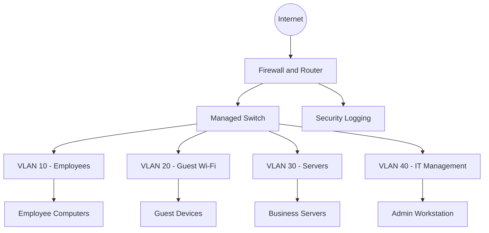

# Proposed Network Architecture

## Security Design Notes

- Guest Wi-Fi should not access internal business systems.
- Server access should be restricted to authorised services.
- Administrative access should be limited to approved devices.
- Inter-VLAN traffic should follow explicit firewall policies.
- Security logs should be protected from unauthorised changes.
